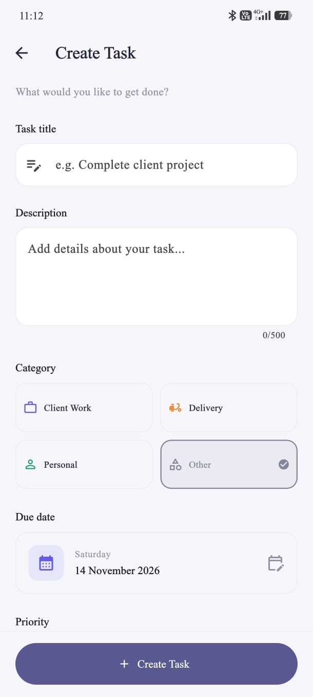
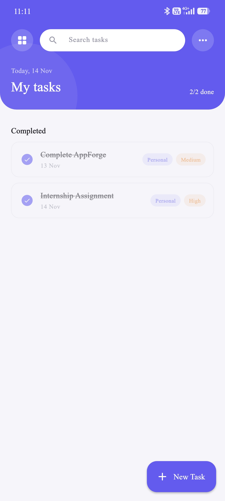
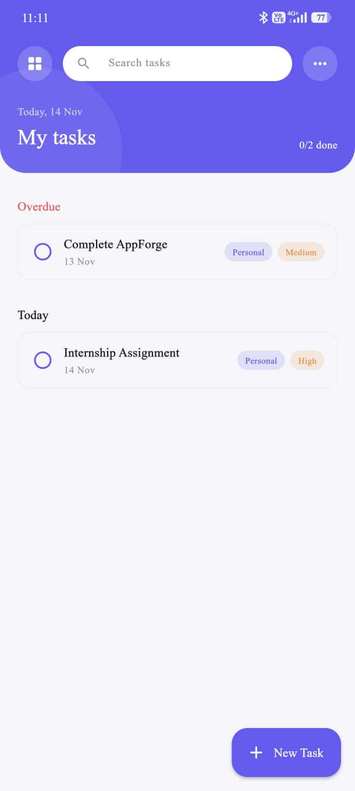
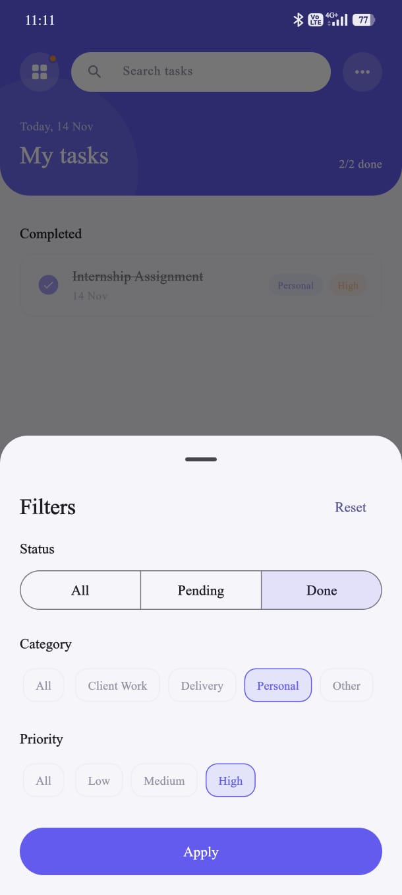
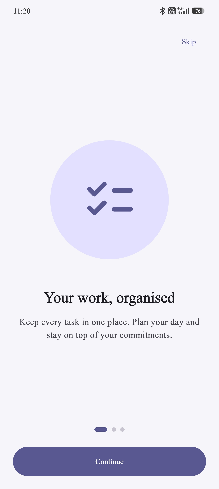
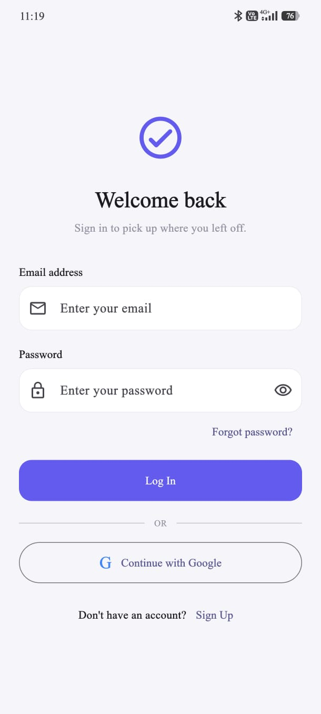

<div align="center">

# Task Manager

**An offline-first task manager for gig workers, built with Flutter and Firebase.**

Create, track and complete work, even with an unreliable internet connection.


</div>

---

## Screenshots

<div align="center">








</div>

## Assignment Requirements

| Requirement | Implementation |
| --- | --- |
| Registration and login with Firebase Auth (email/password) | `AuthService` with sign-up, sign-in, password reset and Google Sign-In |
| Clear error messages for invalid credentials | Firebase error codes mapped to readable messages on the login and sign-up screens |
| Create, edit, delete and view tasks | Add/edit screen, swipe-to-delete with **Undo**, tap a card to edit |
| Fields: title, description, due date, priority (low / medium / high) | Form validation, date picker, priority selector |
| Tasks stored on a backend | Cloud Firestore at `users/{userId}/tasks/{taskId}`, plus a local SQLite cache |
| Mark tasks complete / incomplete | One tap on the checkbox in each task card |
| Filter by priority and status | Always-visible filter chips under the header |
| List sorted by due date, earliest first | Sorted on every update and grouped into Overdue, Today, Tomorrow, This week, Later and Completed |
| Clean, responsive Material UI on iOS and Android | Material 3, custom theme, shared components |

## Features

**Authentication**
- Email and password registration and login
- Google Sign-In
- Password reset by email
- Persistent sessions
- Per-user data isolation

**Task management**
- Full create, read, update and delete
- Categories: Client Work, Delivery, Personal and Other
- Search by title or description
- Filter by status, priority and category
- Pull to refresh

**Offline-first**
- Tasks are saved to SQLite first, so the app works without a connection
- Changes sync to Firestore in the background
- Signing in on a new device restores your tasks
- An offline banner shows connectivity status

**Experience**
- First-launch onboarding
- Native splash screen
- Form validation and friendly error states
- Empty, loading and error states for every screen

## Tech Stack

| Technology | Purpose |
| --- | --- |
| Flutter and Dart | Cross-platform UI |
| Firebase Authentication | Identity (email/password and Google) |
| Cloud Firestore | Remote storage and cross-device sync |
| sqflite | Local persistence for offline use |
| Riverpod | State management |
| GoRouter | Declarative navigation and auth redirects |
| SharedPreferences | Onboarding state |
| Internet Connection Checker Plus | Connectivity monitoring |

## Architecture

```
lib/
├── constants/     # Theme, colours, dimensions, strings
├── models/        # Task model and enums
├── providers/     # Riverpod providers and router
├── screens/       # Onboarding, auth, dashboard, add/edit task
├── services/      # AuthService and TaskService (SQLite + Firestore)
├── widgets/       # Reusable components
└── main.dart
```

```
 Flutter UI  ──►  Riverpod providers  ──►  TaskService
                                             │      │
                                          SQLite  Firestore
                                          (local)  (cloud)
```

The UI only reads from the local database, so it responds immediately. `TaskService` writes locally first, then pushes the change to Firestore. A Firestore listener keeps the local copy up to date.

## Getting Started

### Prerequisites
- Flutter SDK (stable channel) and Dart
- Android Studio or VS Code
- A Firebase project
- Xcode, for iOS builds (macOS only)

### Setup

```bash
# 1. Clone
git clone <your-repository-url>
cd Task_Manager_App

# 2. Install dependencies
flutter pub get

# 3. Configure Firebase
dart pub global activate flutterfire_cli
flutterfire configure

# 4. Generate the splash screen
dart run flutter_native_splash:create --path=flutter_native_splash.yaml

# 5. Run
flutter run
```

**Firebase checklist**
1. Enable **Email/Password** and **Google** under Authentication, then Sign-in method.
2. Create a **Cloud Firestore** database.
3. Add `android/app/google-services.json` and `ios/Runner/GoogleService-Info.plist`.
4. Add your SHA-1 and SHA-256 fingerprints in the Firebase console (required for Google Sign-In on Android).
5. Deploy these Firestore rules:

```
rules_version = '2';
service cloud.firestore {
  match /databases/{database}/documents {
    match /users/{userId} {
      allow read, write: if request.auth != null && request.auth.uid == userId;

      match /tasks/{taskId} {
        allow read, write: if request.auth != null && request.auth.uid == userId;
      }
    }
  }
}
```

## Build

```bash
flutter build apk --release        # Android APK
flutter build appbundle --release  # Android App Bundle
flutter build ios --release        # iOS (macOS + Xcode)
```

## Code Quality

```bash
dart format .
flutter analyze
flutter test
```

## Security

- Firebase Authentication manages identity. Passwords are never stored in the app.
- Firestore rules restrict every user to their own documents.
- Signing keys and service-account files are not committed to the repository.

## Author

**YOUR NAME**
GitHub: [@your-username](https://github.com/your-username)

---

<div align="center">Built with Flutter.</div>